# Solar filament instance segmentation in GONG H-alpha images: technical report

Filament Segmentation Challenge 2026 · submitted model **final-A**: a single network plus 8-view test-time augmentation

| | |
|---|---|
| Submitted model | final-A: one FlashInternImage-L query-based instance segmentation model (223.6 M parameters, EMA weights); 8 dihedral views of the test image are fused at inference |
| Public leaderboard | **PQ 0.40** |
| Held-out fold 0 (120 observations, 192 annotator records, 1,341 filaments), fold-0 twin of the final recipe, submission settings | **PQ 0.446** (SQ 0.678, RQ 0.658) · mean Dice over overlapping GT/prediction pairs **0.728** · torchmetrics `DiceScore` of the filament mask **0.656** per record (0.684 pooled) |
| Agreement between two human annotators (training set) | PQ 0.340 |
| Inference input | the provided 2048 × 2048 H-alpha test image only |

The pipeline in one paragraph: a pretrained FlashInternImage-L backbone (DCNv4) reads a 1024 px view of the full disk for context. A native-resolution detail path reads the 2048 px image together with a local-contrast channel and a limb-darkening-normalized contrast channel. Sixty-four image-seeded instance queries decode one filament each, and every mask is rendered at native resolution. Training directly optimizes a differentiable surrogate of the competition's Panoptic Quality. Training proceeded in stages, each warm-started from the previous one. The last stages add Noisy-Student self-training on unlabelled GONG archive frames, pseudo-labelled by fold-0 teacher models; frames from test-image days are excluded. At test time the eight rotations/flips of the image are segmented, their instances are clustered and averaged, and a pixel-ownership step produces non-overlapping instance masks.

Contents: [1 Data and metric](#1-task-data-and-metric) · [2 Pipeline](#2-pipeline-overview) · [3 Preprocessing](#3-preprocessing-and-inputs) · [4 Architecture](#4-architecture) · [5 Objective](#5-training-objective) · [6 Training stages](#6-training-stages) · [7 Self-training](#7-self-training-on-unlabelled-archive-frames) · [8 Inference](#8-inference-test-time-augmentation-and-instance-selection) · [9 Results](#9-results) · [10 Negative results](#10-what-did-not-work) · [11 Compliance](#11-compliance-with-the-competition-rules) · [12 Reproduction](#12-reproduction) · [13 Code](#13-code-organization-and-quality) · [14 Limitations](#14-limitations-and-possible-extensions) · [References](#references)

---

## 1 Task, data and metric

**Data.** The MAGFiLO training set (Ahmadzadeh et al. 2024; Kaggle 2026 release) has 707 full-disk H-alpha observations from the six GONG sites (Big Bear, Cerro Tololo, Learmonth, Mauna Loa, El Teide, Udaipur), taken in 2011–2022. Each observation is a 2048 × 2048 grayscale JPEG. The set holds 1,154 *annotator records*: 411 observations were drawn by one annotator, 145 by two and 151 by three. The records contain 8,199 filament polygons: 7.1 per record on average (median 7, maximum 26), with median area 1,228 px and 10 % below 410 px. The test set has 180 observations from the same sites and years.

**Metric.** Panoptic Quality is computed per annotator record and pooled over all records: a GT/prediction pair with IoU > 0.5 is a true positive, and PQ = Σ IoU(TP) / (TP + ½ FP + ½ FN). A prediction is therefore scored separately against *every* annotator's version of the same observation.

**The labels disagree.** Different annotators draw different numbers of filaments and split or merge them differently (Fig. 1). Scoring one annotator's record against another's with the same PQ gives **0.340** (598 annotator pairs on 296 observations; SQ 0.634, RQ 0.536; `research/interannotator_agreement.py`). The record-id prefixes behave like stable annotator styles: some annotators systematically draw more, wider or merged filaments. We used this only as analysis (§11).

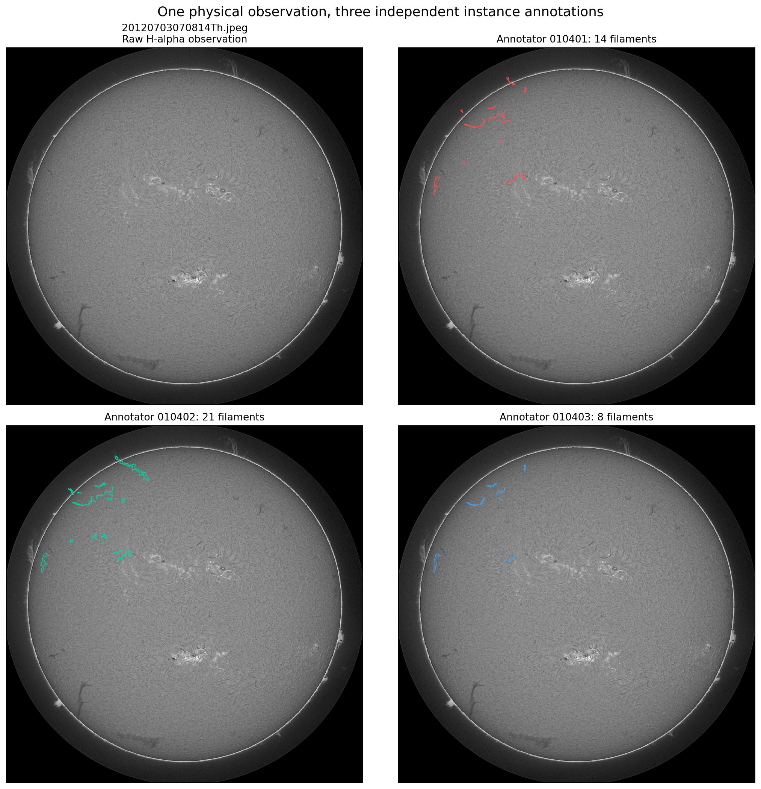
*Figure 1. One observation, three annotator records with 14, 21 and 8 filaments.*

**Validation.** There are five folds by physical observation (SHA-256 of the file name, seed 2026), so all records of one observation stay in the same fold. Fold 0 has 120 observations, 192 records and 1,341 filaments. All model selection used fold 0. The final model was then retrained on all labels and cannot be scored on fold 0 (§6).

## 2 Pipeline overview

```text
 2048 x 2048 H-alpha JPEG (the provided test image)
   |
   +-- context view: antialiased resize to 1024 px, ImageNet normalization
   |       -> FlashInternImage-L (DCNv4, 218.9 M params, ImageNet-22k->1k) -> 4-level context pyramid (192 ch)
   |
   +-- native inputs (2048 px): intensity, local contrast, limb-flattened relative darkness
           -> 2x2 Haar split -> detail path at strides 2 and 4: context fusion + curve residual blocks
              (inference in 512 px tiles with a 48 px halo; identical to the full-image computation)
   |
   query decoder: 64 queries initialized at spatially diverse seed peaks, 6 layers
     (mask-guided cross-attention, global attention every 2nd layer, 256 unpooled seed tokens,
      attention to 64 native foreground/edge points of the query's own mask, mask feedback)
   |
   per query: P(filament), quality (predicted native IoU), 64-d mask embedding + 8-d phase embedding
   mask logits (2048 px) = embedding . stride-2 basis (bilinear) + phase embedding . 4 sub-pixel phase maps
   |
   x 8 dihedral views -> map back -> cluster across views (IoU > .5) -> average probabilities
   -> keep: votes >= 1/8, score >= .10, mask threshold .40, score-ordered pixel ownership, area >= 32 px
   -> non-overlapping instance masks -> RLE submission
```

## 3 Preprocessing and inputs

All preprocessing is computed from the test image itself. No other data source is read at inference.

| Input | Definition | Why |
|---|---|---|
| Context view | Image resized to 1024 px (bilinear, antialiased), replicated to 3 channels, ImageNet mean/std | Lets the pretrained backbone see the whole disk: filaments reach hundreds of pixels in length, and context separates them from sunspots, plage and the limb |
| Intensity | Native 2048 px gray level in [0, 1] | Boundaries: median maximum inscribed width is 14 px, and 10 % of filaments are at most 8 px wide |
| Local contrast | 4 · (I − 15 × 15 box mean of I), computed on the full image | Removes slow brightness variation; full-image computation keeps tiles consistent |
| Limb-flattened relative darkness | 4 · (I / B − 1) on the disk, 0 off-disk, clamped to ±4. B is a normalized convolution blur(I · disk) / blur(disk) at 1/8 resolution (σ ≈ 32 native px), and the disk is I > 0.25 × 99th percentile | Filaments are absorption features. Their contrast against the local quiet-Sun background is the physically meaningful signal, while absolute intensity falls toward the limb. This plays the same role as the limb-darkening corrections of full-disk filament pipelines (e.g. Diercke et al. 2024). Off-disk pixels never enter the background, so the limb is not darkened (`solar_filaments/model.py:limb_flattened`) |

**Training-time augmentation.** With probability 0.5 the image is rotated by a uniform random angle and scaled by 1 ± 0.05 about its center (`rotate_record`). The same transform is applied to the exact polygon vertices, which are then rasterized, so labels are never interpolated. Otherwise the cached geometry gets a random quarter turn and flip. Photometric jitter follows (brightness ±10 %, contrast ±15 %, gamma ±10 %, Gaussian noise σ ≤ 0.005). Backbone stochastic depth is 0.1. Geometry targets (bit-packed native masks, skeleton anchor points, per-instance ROIs) are precomputed once by `scripts/prepare_data.py`.

## 4 Architecture

`solar_filaments/model.py`, `backbone.py`, `detail.py`, `curves.py`, `decoder.py`, `masks.py`. Total 223,597,695 parameters, of which 218,914,640 are in the backbone.

**Context backbone.** FlashInternImage-L (depths [5, 5, 22, 5], channels 160–1280, DCNv4 deformable convolution) uses the authors' ImageNet-22k→1k weights (683 tensors, loaded strictly). Its four stages form a context pyramid (FPN-style lateral projections and refinement, 192 channels). Learning rates decay by stage (0.8 per stage), and the DCN offset/mask parameters use 0.1 × the rate so the small dataset does not disturb the pretrained sampling patterns.

**Native detail path.** The three native input channels are split by an orthogonal 2 × 2 Haar transform. The transform is invertible, so all four sub-pixel phases are available to the learned projection, unlike a strided convolution. Context features are fused into the stride-2 and stride-4 detail features with exact pixel-center coordinate alignment and learned gates. Each scale has a *curve residual block*: an ordinary local convolution plus a narrow residual branch that aggregates features along two orthogonal, continuously bending 7-point curves (inspired by Dynamic Snake Convolution, Qi et al. 2023). The curves map onto the DCNv4 kernel, so no K × C × H × W sample volume is built. Outputs are 192-channel stride-4 pixel features and a 64-channel stride-2 mask basis. At inference the path runs in 512 px tiles with a 48 px halo; the halo covers the receptive field, and a unit test checks equality with the untiled computation.

**Query decoder** (Mask2Former-style, Cheng et al. 2022):
- *Memory*: stride-4 detail features and two context levels, average-pooled to bounded grids (48, 24 and 12 cells on the long side), plus 256 **unpooled seed tokens** at the peaks of a learned seed score. Pooling alone would average an 8 px filament out of a 42 px cell.
- *Queries*: 64 learned queries, each added to the projected feature of one of 64 spatially diverse seed peaks (`query_seeds.py`). This gives image-dependent starting points.
- *Layers*: 6 layers of self-attention, cross-attention and FFN. Cross-attention is restricted to the query's current mask (masked attention), except every 2nd layer, which attends globally so a branch missed by a bad mask can be recovered. After each layer, a **mask feedback** term adds the mask-weighted average of the memory to the query. Each query also attends to **64 native points** (32 foreground peaks and 32 edge points of its own mask) on the stride-4 features, so boundary detail bypasses the pooled memory.
- *Heads*: a 2-way classifier (filament / no object); a quality head trained to predict the query's native-resolution IoU; a 64-d mask embedding; and an 8-d phase embedding.

**Native mask rendering** (`masks.py`). Logits = embedding · stride-2 basis (bilinear to 2048) + phase embedding · the four sub-pixel phase maps (pixel shuffle). Training samples exactly the same function at arbitrary native points, so supervision and inference share one mask definition. One query is one instance, even if its mask has several parts.

**Training-only mask pilots** (MP-Former, Zhang et al. 2023). 32 extra queries receive noised ground-truth masks as attention guides and reconstruct them, in an isolated self-attention branch with shared weights. This stabilizes mask-guided attention early in training and is absent at inference; a unit test checks that normal predictions are unchanged.

## 5 Training objective

`solar_filaments/losses.py`, `panoptic_surrogate.py`. Every image (one annotator record) is matched by the Hungarian algorithm (classification plus point-sampled mask costs). The total loss is

L = L_PQ + 0.02 · mean over images of [ 2 L_class + L_mask + L_fine + 0.5 L_quality + 0.25 L_aux + 0.2 L_seed ].

| Term | Definition |
|---|---|
| **L_PQ** (primary) | Differentiable PQ over the whole batch (all-reduced over GPUs, pooled like the metric), objective −log PQ. This is in the spirit of MaX-DeepLab's PQ-style loss, but evaluated on native-resolution masks with the inference-time ownership rule. It uses 16,384 native pixels per image, drawn from a balanced mixture: 25 % uniform, 37.5 % spread evenly over the GT instances, 37.5 % over predicted support. Inverse-proposal weights make the area estimates unbiased. Each query's confidence is P(filament) · σ(quality) · mean foreground probability. A soft detection probability is σ((confidence − 0.15)/0.05). Soft pixel ownership is a softmax over queries of (log σ(logit) + log confidence + log detection)/0.15, which mirrors the inference-time pixel competition. A soft TP is σ((IoU − 0.5)/0.1) of the owned native mask. Then PQ = Σ detection · TP · IoU / (½ Σ detection + ½ #GT) |
| L_class | Cross-entropy on the matched assignment (no-object weight 0.1) |
| L_mask, L_fine | Point-sampled BCE (×2) + Dice (×5) on 8,192 points for the stride-4 masks and the native refined masks. Fuzzy GT edge bands get 0.75 weight |
| L_quality | BCE between σ(quality) and the best native IoU of the query's hard mask with any GT instance, estimated from the weighted native samples |
| L_aux | The same mask and class losses on intermediate decoder layers, plus the mask-pilot reconstruction |
| L_seed | Balanced BCE of the seed score against GT skeleton occupancy (feeds seed tokens and query initialization) |

Other implemented terms (clDice topology, boundary distance, pixel competition, centerline/boundary heads) have weight 0 in the final recipe. Fold-0 experiments showed that the PQ-aligned objective, not auxiliary shape losses, moved the score (§10).

**Optimization.** AdamW (β = 0.9/0.999, weight decay 0.05, none on norms and biases), gradient clipping 1.0, FP16 autocast with a GradScaler, EMA of the weights with a warm-up (decay min(0.999, (1 + n)/(100 + n)) after n updates, about 0.99 at the end of final-A's 9,224 updates), one-epoch warmup and cosine decay to 2 %, batch 3 per GPU, `torch.compile` (inductor) and activation checkpointing.

## 6 Training stages

Every stage is a small YAML delta on its predecessor (`configs/`, `base:` inheritance) and warm-starts from the previous stage's weights. New modules start at their initialization, and a widened input projection starts with zero weights on the new channel, so the network initially computes the same function (`train.load_warmstart`).

| Stage | Config | Init | Epochs run (selected, 0-based) | Training data | Fold-0 PQ, single view |
|---|---|---|---|---|---|
| S1 | `dual_3090` (on `flash_large`) | ImageNet backbone, new heads | 58 (ep. 57) | fold-0 train split | 0.169 |
| S2 | `pq_aligned_v1`: PQ surrogate as primary loss, native detail attention | S1 | 21 (ep. 10) | same | 0.348 |
| S3 | `pq_seeded_v3` (with `pq_piloted_v2`): mask pilots, image-seeded queries, balanced native sampling, IoU quality target | S2 | 34 (ep. 33) | same | 0.375 (0.392 at tuned thresholds) |
| S4 = **v7** | `pq_recovery_v7`: soft surrogate, log objective, score threshold 0.15, head LR 5e-5 | S3 | 12 (ep. 10) | same | 0.395 |
| E3 | `v9_e0` + `v9_e3`: limb-flattened channel, arbitrary rotation/scale augmentation | v7 | 24 | same | 0.4025 |
| E6 (teacher) | `v9_e6`: E3 + multi-scale backbone views 1024/1152/1280 | v7 | 24 | same | 0.4004 |
| E9 (fold-0 twin) | `v9_e9`: E3 + round-1 pseudo labels (1:1 per epoch) | v7 | 24 | fold-0 train + 2,363 archive frames | 0.413\* |
| F1 | `v9_f1`: E9 recipe on all labels | v7 | 24 | all 1,154 records + 3,028 archive frames (round 1, compliant) | (no held-out data) |
| **final-A** | `v9_ffinal_a`: continue F1 at 0.25× LR (head 1.25e-5, backbone 1.25e-6) | F1 | 12 | all records + 9,272 archive frames (round 2), 1:1 per epoch | (no held-out data) |

\* E9's round-1 pool contained archive frames from fold-0 validation days (never the validation images, and with labels from fold-0 models only). Its fold-0 score is therefore an optimistic estimate (§11).

The fold-0 analyses below use **E9**: the same architecture, losses and self-training recipe as F1/final-A, trained without the fold-0 labels. final-A itself has seen all labelled observations.

## 7 Self-training on unlabelled archive frames

We followed Noisy Student (Xie et al. 2020): a teacher labels unlabelled images, and a student trains on labels plus pseudo-labels under strong noise.

- **Unlabelled data.** GONG H-alpha full-disk frames from the public NSO archive (`gong2.nso.edu`), the same network and instrument as the competition images (`scripts/download_gong.py`). Text and logo overlays outside a radius of 1024 px are masked. Frames are taken from random days in 2011–2022 and from other times of competition observation days. Frames from any **test-image day are excluded** both at labelling and at assembly (`pseudo_label.excluded_days`), and the competition files themselves are never included.
- **Teacher.** Two fold-0 models with test-time augmentation: round 1 E3 + E6, round 2 E9 + E6. In round 2, views d0 and f2 of each model (4 voters) were fused exactly like a submission (votes ≥ 1, score ≥ 0.10) but with a stricter mask threshold of 0.70. Masks become COCO polygons (`scripts/pseudo_label.py`).
- **Pools** (counts verified on the training server): round 1 = 2,030 frames (10,992 filaments) + 998 frames (7,050 filaments) for F1; round 2 = 9,272 frames on 3,465 days (47,336 filaments) for final-A. Fold-0 validation days are excluded from round 2 as well.
- **Student.** Each epoch uses every labelled record plus an equal number of pseudo-labelled frames, freshly sampled from the pool (`data.MixedDataset`). The student noise is arbitrary rotation and scaling, photometric jitter and stochastic depth.
- **Evidence.** The single-view fold-0 score rose from 0.4025 (E3) to 0.413 (E9), an optimistic estimate. On the public leaderboard, v7 + TTA scored 0.37, F1 + TTA (round 1) 0.39 and final-A (round 2) 0.40. A third round with a single-model teacher (final-A, 14.4k frames) lowered the public score to 0.38. Teacher diversity mattered more than pool size.

## 8 Inference: test-time augmentation and instance selection

`scripts/dump_tta_candidates.py` (GPU), then `scripts/fuse_tta.py` (CPU).

1. **Eight dihedral views.** Rotations by k · 90° with and without a horizontal flip. These are exact pixel permutations, so no interpolation blurs thin filaments; arbitrary-angle rotations lowered fold-0 PQ (0.4463 → 0.4440). For each view, every query with score P(filament) · σ(quality) ≥ 0.02 is stored as a probability crop mapped back to the original orientation.
2. **Fusion.** Candidates from all views are ordered by score and clustered by IoU > 0.5 of their p ≥ 0.5 masks, with at most one member per view. Probabilities are averaged over members, and the fused score is the summed member score divided by 8.
3. **Selection and ownership.** A fused instance is kept when it has ≥ 1 vote and score ≥ 0.10, and after binarizing at **0.40** its score × mean probability is still ≥ 0.10. Instances then claim pixels in a score-ordered competition (confidence = probability × score). An instance is dropped if fewer than 32 px or less than 50 % of its area survive. The result is non-overlapping masks and at most one prediction per filament.
4. **Thresholds.** The thresholds were chosen on fold 0 and checked against the public leaderboard; we did not tune on the leaderboard. A lower mask threshold widens masks and turns near misses into matches. On fold 0, mask 0.60 / 0.50 / 0.40 / 0.35 gave PQ 0.4433 / 0.4448 / 0.4461 / 0.4472, and lower values fell again. We use 0.40, close to the IoU-optimal pixel threshold J/(1+J) ≈ 0.40 for an achievable IoU J ≈ 0.68 (Nowozin 2014), rather than the fold-0 maximum.

Inference cost: about 3.7 s per test image for 8 views on one RTX 3090, plus about 1 min of CPU fusion for the 180 test images. The submission has 1,072 instances on 179 of the 180 test images, with no overlapping pixels and areas of 253–23,490 px (median 1,385). `scripts/validate_submission.py` checks the file.

## 9 Results

### 9.1 Leaderboard history (public, about 50 % of the test set)

| Date | Submission | Public PQ |
|---|---|---|
| 10-23 | S3, single view | 0.33 |
| 10-25 | v7 + 8-view TTA | 0.37 |
| 10-27 | 4–6 model ensembles (fold-0 up to 0.452) | 0.38 |
| 10-27 | F1 + 8-view TTA (single model) | 0.39 |
| 10-27 | **final-A + 8-view TTA (submitted)** | **0.40** |
| 10-27/28 | later continuations of final-A (§10) | 0.38–0.39 |

Fold-0 PQ runs about 0.05 above the public score. We checked two explanations. Temporal proximity to training observations does not explain it: re-weighting fold 0 to the test set's mix of observations with and without a training observation within 24 h leaves PQ unchanged (`scripts/neighbor_split_pq.py`). Randomly omitting about 31 % of fold-0 GT instances reproduces the public level (`scripts/sparsity_threshold_sim.py`), which is consistent with sparser test annotations. Both were measured with an earlier ensemble's fold-0 predictions.

### 9.2 Judging metrics on fold 0

`scripts/rubric_metrics.py` follows the organizers' self-evaluation notebook. It computes the per-record PQ, the IoU and Dice of every overlapping (IoU > 0) GT/prediction pair, and the one-to-many and many-to-one relations. It adds the **semantic Dice of the binary filament mask computed with `torchmetrics`** (`dice_score`, the functional form of `DiceScore`, filament class, per record). That value agrees with an independent RLE computation to 3 × 10⁻⁸. The setting is the submission setting, and the v7 model, trained without external data, is shown as a reference.

| Fold 0, 8-view TTA, votes 1/8, score 0.10, mask 0.40 | **final recipe (E9)** | v7 reference |
|---|---|---|
| PQ (SQ / RQ) [95 % CI] | **0.446** (0.678 / 0.658) [0.420, 0.471] | 0.436 (0.676 / 0.645) [0.407, 0.463] |
| TP / FP / FN | 810 / 311 / 531 | 790 / 320 / 551 |
| Mean Dice, overlapping pairs (median) [95 % CI] | **0.728** (0.785) [0.712, 0.744] | 0.711 (0.773) [0.690, 0.730] |
| Mean IoU, overlapping pairs (median) [95 % CI] | 0.597 (0.646) [0.580, 0.614] | 0.580 (0.630) [0.559, 0.600] |
| torchmetrics DiceScore per record: mean / median / pooled | 0.656 / 0.692 / 0.684 | 0.660 / 0.697 / 0.691 |
| One-to-many: GT overlapped by 0 / 1 / 2 / 3 predictions | 316 / 1,001 / 24 / 0 | 306 / 1,005 / 27 / 3 |
| Many-to-one: prediction overlapping 0 / 1 / 2 / 3 GT | 131 / 935 / 51 / 4 | 122 / 917 / 62 / 9 |

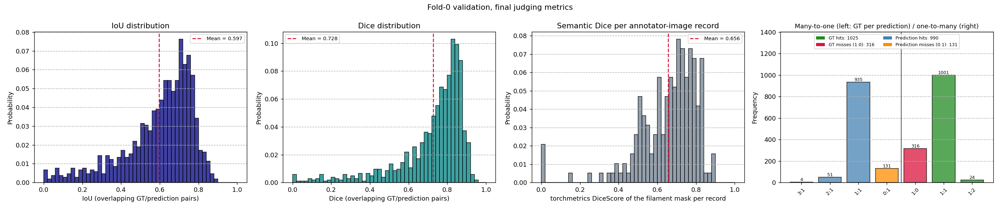
*Figure 2. Fold 0, final recipe. IoU and Dice of all overlapping GT/prediction pairs, semantic DiceScore per annotator record, and the one-to-many (right) and many-to-one (left) relations. The v7 reference is in `figures/rubric_fold0_v7/`.*

How to read this table:
- **Dice and IoU.** Pair Dice is unimodal: median 0.785, interquartile range 0.68–0.84, 10th percentile 0.50. The low tail is overlaps that are not matches: partial extents, and one prediction covering two drawn fragments.
- **One-to-one structure.** 97.7 % of the GT filaments that any prediction overlaps are overlapped by exactly one. 94.4 % of predictions that overlap GT overlap exactly one GT instance. Splits (24) and merges (55) are rare. The remaining errors are mostly whole filaments that are missed (316 with no overlap at all) or predicted where the annotator drew nothing (131).
- **Final recipe vs v7.** Self-training improved PQ by +0.010 [0.000, 0.020] and pair Dice by +0.018 [0.006, 0.031], with fewer merges (55 vs 71) and splits (24 vs 30). The brackets are paired 95 % bootstrap intervals over observations (`rubric_metrics --compare`). The pixel-level semantic Dice did not change measurably (−0.004 [−0.016, 0.009]): the gain is in instance correctness, not in the total filament area. For scale, on 90 observations (one leaderboard half) the PQ of a single model varies with an SD of about 0.014.
- **Semantic Dice per record.** It is lowest for sparse records (0.61 with 1–3 filaments, where one miss weighs heavily) and highest with 8–12 filaments (0.69). Four records score 0. In three of them (two observations) the model predicted nothing where the annotators drew 1–3 filaments; in the fourth, three predictions miss the single drawn filament. The same prediction's semantic Dice differs by 0.13 on average between the annotator records of one observation, so the labels themselves cap pixel metrics.

### 9.3 Where PQ is lost

`scripts/error_modes.py` and `scripts/attribute_misses.py`, fold 0, final recipe.

| Error | Count | Breakdown |
|---|---|---|
| FN, no candidate: no kept prediction with IoU > 0.1 and no fused candidate with IoU > 0.5 | 296 | by area: 188 small (< 800 px), 90 medium, 18 large. On multi-annotator observations, 120 were drawn by a minority of annotators and 44 by a majority |
| FN, near miss: a kept prediction overlaps it with IoU 0.1–0.5 | 198 | prediction too large 96, too small 67, shifted 35. A prediction spanning 2+ GT 66, a GT split over 2+ predictions 15 |
| FN, low score: a fused candidate below the selection rule has IoU > 0.5 | 37 | |
| FP, near miss: overlaps a GT instance of that record with IoU 0.1–0.5 | 176 | the extent/granularity counterpart of the FN near misses |
| FP, unlabelled: no GT instance of that record with IoU > 0.1 | 135 | the annotator did not draw it, or a false detection |

The decoder usually *finds* the missed filaments. In single-view miss attribution, 83 % of the 631 GT filaments missed by view d0 overlap some query: 22 % at IoU > 0.5 but with a low score, 37 % at IoU 0.3–0.5 and 25 % at 0.1–0.3. Only 17 % are never proposed, and half of those are below 500 px. The dominant errors are therefore extent and granularity decisions on which annotators also disagree (§1), plus small, faint, often minority-drawn filaments. For context, matched IoU (SQ 0.678) already exceeds the annotator-vs-annotator SQ (0.634).

### 9.4 Morphology of the predicted segmentations

`scripts/morphology_figures.py` and `scripts/shape_statistics.py`. Qualitative examples (top: full disk; bottom: 512 px window around the largest predicted filament):

| Fold 0 (with all annotator records) | Test (final-A submission) |
|---|---|
| 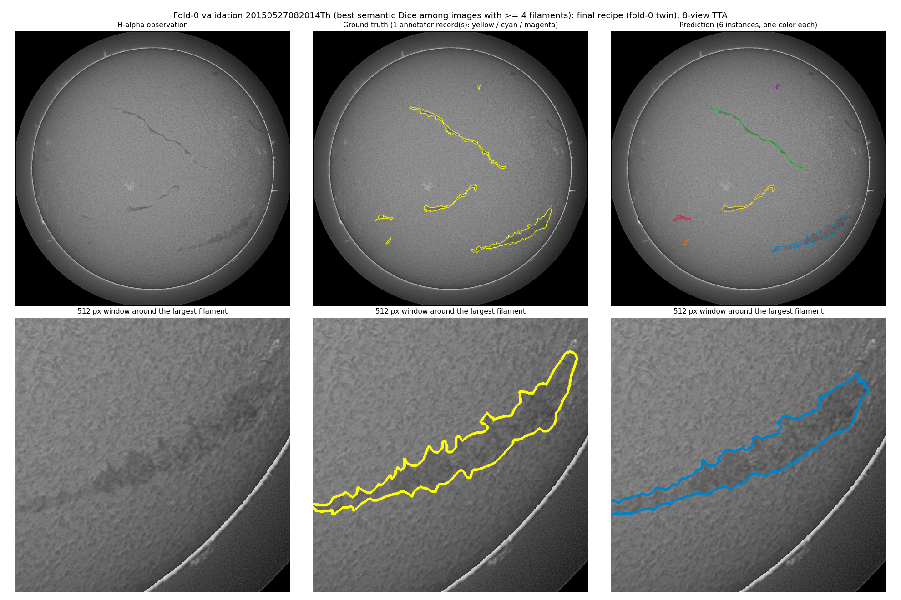 | 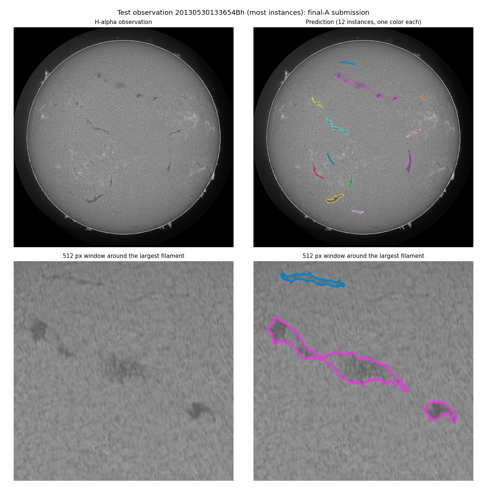 |
| 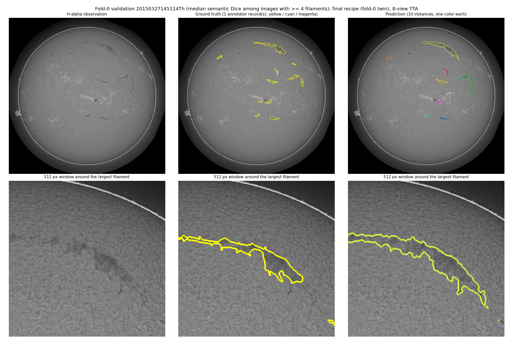 | 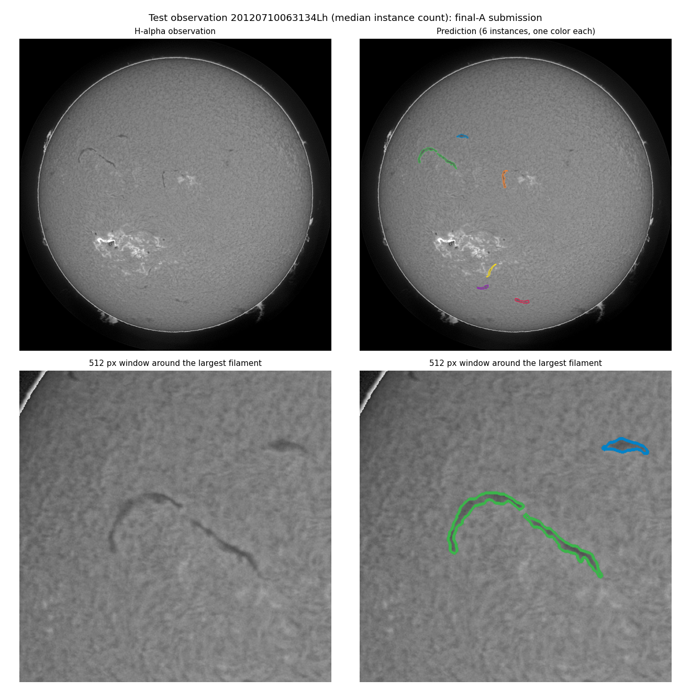 |
| 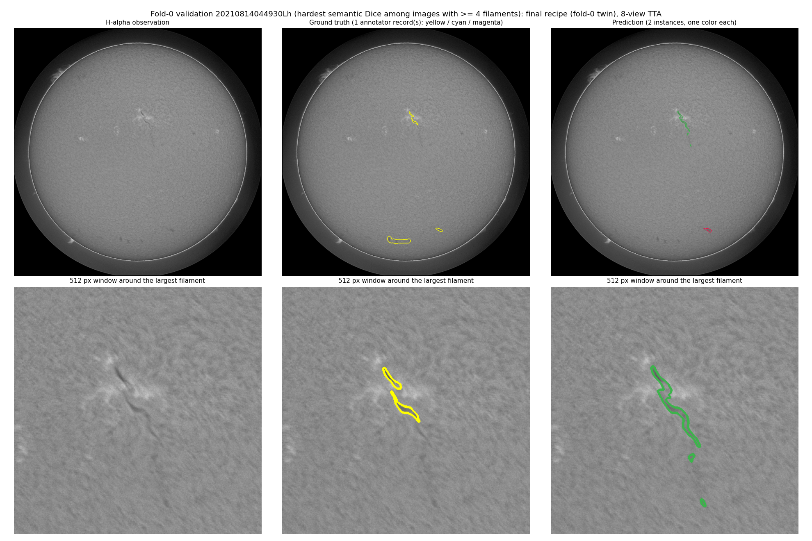 | 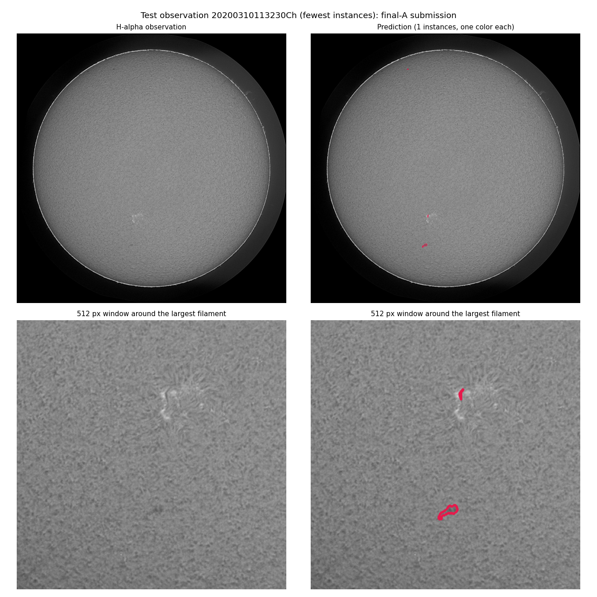 |

*Figure 3. Fold-0 rows are the best, median and hardest semantic-Dice observations among those with ≥ 4 filaments. Test rows are the observations with the most, a median and the fewest predicted instances.*

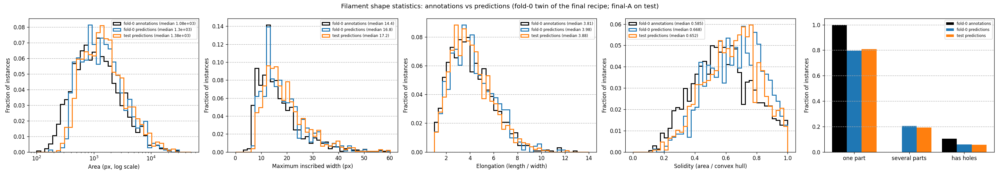
*Figure 4. Shape descriptors of fold-0 annotations (black), fold-0 predictions (blue) and final-A test predictions (orange).*

| Descriptor (median) | Fold-0 annotations | Fold-0 predictions | Test predictions |
|---|---|---|---|
| Area (px) | 1,076 | 1,296 | 1,385 |
| Maximum inscribed width (px) | 14.4 | 16.8 | 17.2 |
| Elongation (length / width) | 3.81 | 3.98 | 3.88 |
| Solidity (area / convex hull) | 0.58 | 0.67 | 0.65 |
| Instances with several parts | 0 % | 20.5 % | 19.2 % |
| Instances with holes | 10.4 % | 5.9 % | 5.6 % |

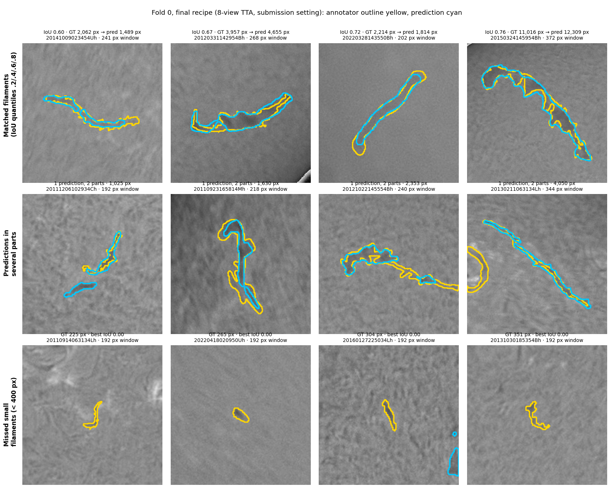
*Figure 5. Fold-0 close-ups, chosen at fixed positions of sorted lists rather than by hand (`scripts/morphology_details.py`). Top: matched filaments at the 20/40/60/80th IoU percentile. Middle: predictions made of several parts (146 of 711 fold-0 predictions). Bottom: missed filaments under 400 px (122 such misses). Annotator outlines yellow, predictions cyan.*

What the shapes show:
- **Faithful filaments.** Predicted instances follow the dark filament spines and their curvature. They keep elongated shapes (elongation matches the annotations) and follow barbs and ragged edges at native resolution (bottom rows of Fig. 3). Test predictions have the same shape distribution as the fold-0 predictions, so there is no visible domain shift on the test set.
- **Slightly wider, smoother outlines.** Predictions are about 2.5 px wider and more convex than the hand-drawn polygons. In Fig. 5 (top row) the predicted outline follows the filament body but not the jagged steps of the hand-drawn polygon, and in these examples the largest differences are at the ends of the filament. Part of this is deliberate: the 0.40 mask threshold widens masks because, under annotator disagreement, a slightly generous outline matches more annotators at IoU > 0.5 (§8). Annotators also trace fine barbs that the averaged prediction smooths.
- **Instances in several parts.** One fifth of the predicted instances consist of several disconnected parts, while every annotated instance is a single polygon. In the close-ups (Fig. 5, middle row), the break is mostly where a long filament's contrast drops: the prediction stops and resumes, and the annotator draws one continuous polygon across the gap. Sometimes a nearby dark fragment is attached to the filament instead. Splitting predictions into connected components did not improve fold-0 PQ (§10).
- **Small and faint filaments.** Predictions rarely go below about 250 px (Fig. 4, area panel). The smallest annotated filaments (100–400 px) and low-contrast ones are the most frequent misses: in Fig. 5 (bottom row), compact faint features of 225–351 px get no overlapping prediction at all. The hardest fold-0 example shows both typical failures. An active-region filament that the annotator drew as two segments is predicted as one longer instance that also follows its faint continuation. Two low-contrast quiet-Sun filaments near the southern limb are missed.
- **Context.** In the median example, a long quiet-Sun filament is segmented over its full length with most of its barbs. The model also outlines some faint filaments that this annotator skipped. This is the "unlabelled" FP category of §9.3, and other annotators often do draw such filaments.

### 9.5 Why the score saturates: the visibility of filaments

Sources: `research/label_visibility.py` (fold-0 predictions of E9 at the submission setting) and `research/magnetogram_pil.py`. Outputs: `research/label_visibility.json` and `research/magnetogram_pil.json`.

Filaments are absorption features. For every annotated filament we measured:
- its cloud-model contrast C, the mean of I/B − 1 inside the polygon, with B the on-disk background of §3;
- its area;
- its disk position μ.

On the 296 multi-record training observations (4,993 filaments), its *agreement* is the share of the other annotators who drew it at IoU > 0.5. On fold 0 we recorded whether the model matched it (IoU > 0.5), near-missed it (best IoU 0.1–0.5) or missed it entirely (best IoU ≤ 0.1).

| Contrast C | < −0.20 | −0.20…−0.14 | −0.14…−0.10 | −0.10…−0.07 | −0.07…−0.04 | > −0.04 |
|---|---|---|---|---|---|---|
| Annotated filaments (multi-record observations) | 41 | 601 | 1,357 | 1,563 | 1,122 | 309 |
| Annotator agreement | 0.79 | 0.66 | 0.66 | 0.55 | 0.40 | 0.25 |
| Model matched (fold 0) | 0.61 | 0.78 | 0.73 | 0.60 | 0.40 | 0.17 |
| Model missed without overlap (fold 0) | 0.00 | 0.10 | 0.16 | 0.26 | 0.40 | 0.65 |

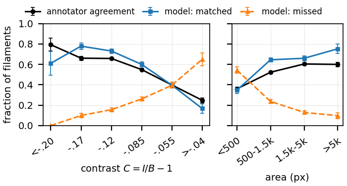
*Figure 6. Annotator agreement and the fold-0 model's match and miss rates against the contrast C (bin centres) and the area.*

- **The labels are visual detections near a contrast threshold.** Agreement falls monotonically with contrast (Spearman −0.28). It also falls with size (0.36 below 500 px, 0.60 above 1,500 px). Size and contrast are not confounded: fainter filaments are, if anything, larger (Spearman 0.29), yet they are agreed on less often.
- **Most labels sit within a few σ of the chromospheric texture.** Fibrils, mottles and noise give I/B − 1 a robust per-pixel spread σ on the inner disk (median 0.048 over observations; 10th–90th percentile 0.036–0.061). Expressed in that unit:
  - 58 % of all 8,199 annotated filaments are less than 2σ darker than the texture, and only 10 % exceed 3σ;
  - agreement is 0.26 below 1σ, 0.49 at 1–2σ, 0.66 at 2–3σ and 0.70 beyond 3σ.
- **The limb is a geometric effect, not a contrast effect.** Agreement falls toward the limb (0.37 at μ < 0.5, against 0.57 at μ ≥ 0.85). Yet limb filaments are as dark as central ones (median C −0.089 against −0.094) and larger (median 1,846 against 1,116 px). There the elevated filament is seen obliquely, and its projected outline is ambiguous.
- **The model's misses follow the same curve.** Its match rate equals or exceeds the human agreement in every contrast bin except the darkest (18 filaments, extent errors) and the faintest. In texture units it falls short only below 1σ (0.15 against 0.26). This is why recall-oriented changes (§10) did not pay off: they push detection into the regime where annotators agree only 25–40 % of the time.

**Model vs. human on the same observations.** The 47 fold-0 observations with several records were scored both ways with the same Hungarian matching:

| Same 47 multi-record fold-0 observations | PQ at IoU > 0.3 / 0.4 / 0.5 / 0.6 | Reference filaments matched / near miss / absent |
|---|---|---|
| Model vs. each record (119 pairs) | 0.483 / 0.468 / **0.430** / 0.347 | 60.0 / 15.9 / 24.1 % |
| Record vs. record (194 ordered pairs) | 0.408 / 0.378 / 0.327 / 0.222 | 51.8 / 27.2 / 21.0 % |

The model agrees with the annotators better than they agree with each other at every IoU threshold, and the gap widens as the threshold gets stricter. At IoU > 0.5 the 95 % bootstrap intervals are model 0.430 [0.391, 0.465] and annotators 0.327 [0.283, 0.371], with a paired difference of +0.103 [0.076, 0.129]; the model was better in all 4,000 resamples. It draws extents more consistently than a second annotator: near misses are 15.9 % against 27.2 %. It misses slightly more faint filaments entirely.

**A magnetic check.** Filaments lie above polarity inversion lines (PILs) of the photospheric field, and H-alpha cannot show this.
- *Pairs.* `research/magnetogram_pairs.csv` pairs each of the 707 training observations with a line-of-sight magnetogram:
  - 612 GONG QuickReduce `bqa` 10-minute averages from the same site, 610 of them within 15 min;
  - 95 SDO/HMI `hmi.M_720s` maps, 92 of them within 12 min. One HMI file is unreadable.
- *Mapping.* The maps are turned north-up and mapped onto the H-alpha disk through the two limb fits; the plage/|B| correlation verifies the mapping.
- *PILs.* The maps are smoothed at σ = 18.5 Mm, and PILs are where the +0.5 G and −0.5 G regions touch.

| Share within 20 Mm of a PIL | |
|---|---|
| Random on-disk points | 4.9 % (median distance 174 Mm) |
| Annotated filaments (8,182 on 706 observations) | **23.3 %** (median distance 57 Mm) |
| … by contrast: C < −0.10 / −0.10…−0.07 / > −0.07 | 22.7 / 23.4 / 24.3 % |
| … by agreement: < 0.34 / 0.34–0.67 / ≥ 0.67 | 23.7 / 23.5 / 23.9 % |
| Fold 0: matched predictions / near misses / unsupported predictions / missed filaments | 24.4 / 25.3 / 22.0 / 23.0 % |
| Centre to limb, filaments / random points: μ ≥ 0.85 / 0.6–0.85 / < 0.6 | 30.1 / 7.3 %, 18.3 / 4.6 %, 12.0 / 2.9 % (enrichment 4.1, 4.0, 4.1) |

- **The annotations recover the physical association.** Filaments are 4.8× enriched near PILs. Only about a quarter lie within 20 Mm at any detector setting we tried, and the HMI subset gives 19.5 %. Per filament, proximity to a PIL is therefore a weak signal.
- **The magnetograms, not the filaments, lose the PILs toward the limb.** The share falls from 30 % at disk centre to 12 % near the limb, but random points fall in proportion, so the enrichment stays near 4. The line-of-sight component of the mostly vertical photospheric field scales with μ, so weak PILs drop below detection near the limb. At this smoothing scale, the filaments' height does not visibly displace them from the PILs.
- **Proximity does not separate the model's errors from its hits.** Unsupported predictions are as close to PILs as matched ones, which supports reading many of them as real filaments that this annotator skipped. Misses are set by visibility, not by a different magnetic configuration.
- **Evidence, not a training signal.** H-alpha cannot show polarity, and the PIL maps are incomplete. The magnetograms are used for this analysis only and are never read in training or inference (§11).

## 10 What did not work

Every change was tested on fold 0, and for the final track on the public leaderboard. Changes below a pre-registered gain (+0.003 fold-0 PQ, or no public improvement) were not adopted.

| Area | Experiment | Result |
|---|---|---|
| Objective | Straight-through discrete-PQ forward (v4); two higher-LR restarts (v5, v6) | fold-0 0.375 → 0.322; 0.329; 0.352. The soft surrogate at lower LR (v7) reached 0.395 |
| Objective | Strong auxiliary shape-loss mixture (E1a/E1b) | PQ and mask losses worsened |
| Objective | Hurdle quality target, IoU · 1[IoU > 0.5] | 0.4063 → 0.3975 |
| Architecture | Curve-query decoder with dynamic spatial mask head (v8, 32 epochs) | best 0.3906 < v7 0.3951 |
| Architecture | Multi-scale Mask2Former memory, max-pooled attention masks (E2) | never above 0.3903 |
| Architecture | CondInst dynamic mask head | paired −0.0016 |
| Architecture | K = 3 multi-hypothesis decoder, relaxed winner-takes-all | −0.004 per hypothesis; fused 3 × 8 views +0.0015 |
| Preprocessing | Robust two-stage flat field instead of the normalized-convolution channel | neutral |
| Regularization | Drop-path variation | +0.0015 (below the bar) |
| Optimizer | SAM (pytorch-optimizer, ρ = 0.05) continuation of final-A on 2 GPUs | public 0.39 after epochs 2 and 4 |
| Resolution | 1280/1536 px backbone view fine-tuning | training PQ loss plateaued above final-A's (0.96–0.98 vs 0.92) |
| Data | Round-3 self-distillation from final-A alone (14.4k frames) | public 0.38 |
| Data | FixMatch / Mean-Teacher consistency on 42.6k unlabelled frames | fold-0 +0.0007, public 0.39 |
| Data | Multi-frame teacher: same-day frames aligned for differential rotation and fused | fold-0 gate 0.433 < 0.443 |
| Data | Physical copy-paste of small filaments (imposing the donor's relative absorption on the target disk) | public 0.38 (more instances: recall up, precision down) |
| Inference | 4–6 model ensembles | fold-0 0.448–0.452, public 0.38 |
| Inference | Weight averaging (model soups) | 0.4006 < 0.4060; 0.4029 < 0.4130 |
| Inference | Multi-scale TTA (1024 + 1280 views) | fold-0 0.448 vs 0.443, public 0.38 |
| Inference | Arbitrary-angle rotation TTA | 0.4463 → 0.4440 |
| Post-processing | Connected-component split/merge, hysteresis, hole filling, smoothing, size-dependent thresholds, GBM re-scorer, exact Dinkelbach/MWIS selection | all ≤ +0.002 |
| Metadata | Annotator-conditioned queries | +0.002 on a fold-0 probe; removed because annotator codes are ground-truth metadata (§11) |

The pattern: once the model is trained against PQ itself, the remaining error is dominated by annotation granularity, which further fine-tuning on the same labels cannot resolve. Diverse teachers on new unlabelled data were the only lever that kept moving the public score.

## 11 Compliance with the competition rules

The rules allow external data but require that "(1) for inference of ML models, only the H-alpha images provided in the test directory will be used; and (2) the models may not use any other ground-truth metadata for training."

- **Inference** reads only the provided test image. All inputs (§3) are computed from it, and the 8 TTA views are transformations of it. No other observation, magnetogram or metadata is read.
- **Training labels** are only the competition segmentation polygons and our own pseudo-labels. Annotator codes in record ids, chirality, spine and bounding-box fields are not used. An annotator-conditioned decoder was prototyped and **removed** for this reason; its code is not part of the release. Annotator analysis appears only in this report (§1, §9.3).
- **External data** are unlabelled GONG archive H-alpha frames, pseudo-labelled by our fold-0 models.
- **Magnetograms** (GONG and SDO/HMI, §9.5) appear only in an offline analysis of the training labels. No model reads them, in training or at inference.
- **Test images were never used for training or self-training.** As an extra precaution, no archive frame observed on any test-image day is in the training data of F1 or final-A. Checked on the server: 0 of 2,030 + 998 + 9,272 frames. Disclosure: the fold-0 experiment E9, which served as one of the two round-2 teachers, was trained with an earlier round-1 pool that still contained 333 archive frames from test-image days. They were other observations, never the test images, and were labelled by fold-0 models. That pool was not used for any submitted model.
- **No leaked labels.** The public MAGFiLO full release, which contains test labels, and leaderboard notebooks with embedded predictions were never used.

## 12 Reproduction

The README lists the commands. Main entry points:

| Step | Command |
|---|---|
| Environment | `pip install -e .`, `python scripts/build_dcnv4.py` (official DCNv4 CUDA kernel), `python scripts/download_weights.py` (ImageNet backbone, training only) |
| Geometry cache | `python scripts/prepare_data.py --config configs/v9_ffinal_a.yaml` |
| Training stage | `python -m torch.distributed.run --standalone --nproc_per_node=<gpus> -m solar_filaments.train --config configs/<stage>.yaml --init-from <previous weights>` |
| Archive frames and pseudo-labels | `scripts/download_gong.py`, `scripts/pseudo_label.py` (+ `assemble`) |
| Test inference | `python -m scripts.dump_tta_candidates --checkpoint weights/final_a.pt --split test --output runs/tta/final_a/test` |
| Submission | `python -m scripts.fuse_tta --folders runs/tta/final_a/test --votes 0.125 --scores 0.10 --masks 0.40 --test --output submission.csv` |
| Judging metrics | `python -m scripts.rubric_metrics …`, `scripts.shape_statistics`, `scripts.morphology_figures`, `scripts.morphology_details` |
| Label visibility, magnetogram check | `python research/label_visibility.py --folder <fold-0 dump>`, `python research/magnetogram_pil.py --folder <fold-0 dump>` |
| Everything above in one place | `notebooks/end_to_end.ipynb`: settings flags select inference (default), fold-0 metrics, analyses and training |

Artifacts:
- `weights/final_a.pt`: SHA-256 `6784bcc3…48933cb`, 894.7 MB, EMA weights after epoch 12, `model_config` embedded.
- `deliverables/submission_single_ffinal_a_m40.csv`: SHA-256 `d5896cfb…c20bf1e`.

Hardware: rented RTX 3090 (24 GB) ×2 and RTX 5090 (32 GB). PyTorch 2.10 + CUDA 12.8. final-A's 12 epochs took 3.3 h on one RTX 3090.

## 13 Code organization and quality

| Path | Content |
|---|---|
| `solar_filaments/` | The package: `config` (dataclass + YAML inheritance, checkpoint compatibility), `data` (records, folds, augmentation, pseudo-label mixture), `geometry` (cached targets), `backbone`, `detail`, `curves`, `decoder`, `query_seeds`, `piloting`, `masks`, `model`, `losses`, `panoptic_surrogate`, `inference`, `fast_eval`, `metrics` (official PQ), `runtime` (AMP, EMA, compile, prefetch), `train`, `predict`, `evaluate`, `ops/` (DCNv4 wrapper with `torch.library` registration), `vendor/` (FlashInternImage, MIT) |
| `configs/` | The final stage chain (`flash_large` → … → `v9_ffinal_a`), teacher `v9_e6`, `local` (inference settings), `diagnostic` (tiny model for tests) |
| `scripts/` | Data and weights setup, archive download, pseudo-labelling, TTA dump/fusion/validation, judging metrics, morphology, error analyses, packaging |
| `tests/` | 33 unit tests: DCNv4 packing and gradients, tiling equivalence, loss/backward on empty and mixed batches, PQ edge cases (strict threshold, split/merge penalties, pooled counts), mask-pilot isolation, native-point / render consistency, warm-start exactness, fast evaluation vs reference, checkpoint handling. 2 tests need the CUDA extension |
| `notebooks/` | `end_to_end.ipynb`: installation, checks, unit tests, test inference and submission, judging metrics, analyses and the training chain |
| `research/` | Inter-annotator agreement, label visibility, the magnetogram/PIL check (with its pairing list), dataset geometry statistics and a PQ upper bound; `research/README.md` lists each script, its output and its key result |
| `docs/` | This report and all figures, plus analysis outputs (`docs/analysis/`) |
| `paper/` | The 4-page report in the organizers' Overleaf template (ACM `acmart`, sigconf) with its figures |

**Release cleanup.** Experimental branches that were not adopted were removed before release: annotator conditioning, multi-hypothesis training, consistency training, copy-paste, SAM, CondInst and curve decoders, multi-scale memory and the robust flat field. Removal was verified to be exact. A deterministic CPU harness compared the package before and after the cleanup: forward outputs (tiled and untiled), selected instances, every loss term and every parameter gradient were bitwise identical, as were 12 augmented dataset samples. final-A loads strictly into the released code (939 tensors). Old checkpoints that store retired options load only if those options were off (`config.checkpoint_config`).

## 14 Limitations and possible extensions

- **Annotation granularity and visibility are the ceiling.** Most remaining errors are of two kinds, and annotators disagree on both:
  - extent and split/merge decisions;
  - faint filaments near the visibility threshold (§9.5).

  Modelling the annotators would help, but rule (2) forbids it. The compliant route is to learn granularity from more diverse self-training teachers.
- **Small filaments.** Filaments under about 400 px are under-detected. Higher-resolution context did not help in short fine-tuning (§10); a model trained from the start at 1280–1536 px might.
- **Instance convention.** About 20 % of predicted instances have several parts. A learned rule to split or keep such parts, matching each annotator convention, is open.
- **Cost.** 223 M parameters and 8 views take about 3.7 s per image on a 3090. A single view loses about 0.03 PQ on fold 0.

## References

- Ahmadzadeh, A., et al. A dataset of manually annotated filaments from H-alpha observations (MAGFiLO). Scientific Data 11, 1031, 2024. https://doi.org/10.1038/s41597-024-03876-y
- Beckers, J. M. A Study of the Fine Structures in the Solar Chromosphere (cloud model). PhD thesis, Utrecht University, 1964.
- Martin, S. F. Conditions for the Formation and Maintenance of Filaments. Solar Physics 182, 1998.
- Scherrer, P. H., et al. The Helioseismic and Magnetic Imager (HMI) Investigation for the Solar Dynamics Observatory. Solar Physics 275, 2012.
- Carion, N., et al. End-to-End Object Detection with Transformers (DETR). ECCV 2020.
- Cheng, B., et al. Masked-attention Mask Transformer for Universal Image Segmentation (Mask2Former). CVPR 2022.
- Zhang, H., et al. MP-Former: Mask-Piloted Transformer for Image Segmentation. CVPR 2023.
- Xiong, Y., et al. Efficient Deformable ConvNets: Rethinking Dynamic and Sparse Operator for Vision Applications (DCNv4, FlashInternImage). CVPR 2024.
- Qi, Y., et al. Dynamic Snake Convolution Based on Topological Geometric Constraints for Tubular Structure Segmentation. ICCV 2023.
- Xu, G., et al. Haar wavelet downsampling. Pattern Recognition 2023.
- Kirillov, A., et al. Panoptic Segmentation. CVPR 2019.
- Wang, H., et al. MaX-DeepLab: End-to-End Panoptic Segmentation with Mask Transformers. CVPR 2021.
- Xie, Q., et al. Self-training with Noisy Student improves ImageNet classification. CVPR 2020.
- Nowozin, S. Optimal Decisions from Probabilistic Models: the Intersection-over-Union Case. CVPR 2014.
- Sohn, K., et al. FixMatch: Simplifying Semi-Supervised Learning with Consistency and Confidence. NeurIPS 2020.
- Foret, P., et al. Sharpness-Aware Minimization for Efficiently Improving Generalization. ICLR 2021.
- Diercke, A., et al. A universal method for solar filament detection from H-alpha observations using semi-supervised deep learning. A&A 2024.
- Shit, S., et al. clDice: a Novel Topology-Preserving Loss Function for Tubular Structure Segmentation. CVPR 2021.
- Harvey, J. W., et al. The Global Oscillation Network Group (GONG) project. Science 1996. GONG H-alpha data: NSO/NISP.
